# NomadPick (노마드픽)

<p align="center">
  <a href="https://fsclass-n.github.io/nomadpick/"></a>
  <br><sub>▶ 썸네일을 누르면 영상 페이지(GitHub Pages)가 열리고 바로 재생됩니다</sub>
</p>

> RPA 기반 **개인 맞춤형 여행상품 추천** 서비스 — 3조 (김길동(조장), 박미금, 이오리, 홍기흥)

RPA(Playwright)가 여러 여행사(하나투어 · 모두투어 · 노랑풍선)의 특가 정보를 30분마다 수집하고, pandas로 정제하여 TiDB에 적재한 뒤
사용자 선호도(지역 · 예산 · 출발월 · 기간 · 테마)에 맞는 상품을 웹에서 추천합니다.

| 구분 | 주소 |
|---|---|
| 프런트엔드 (1단계, Netlify) | https://nomadpick.netlify.app |
| 최종 도메인 1차 (Render) | https://nomadpick.onrender.com |
| 최종 도메인 2차 (AWS EC2) | https://nomadpick.duckdns.org |
| API 문서 (Swagger) | `/docs` |

## 발표·시연 영상

| 항목 | 내용 |
|---|---|
| 영상 페이지 | https://fsclass-n.github.io/nomadpick/ (GitHub Pages, `index.html` 의 video 태그로 바로 재생·챕터 이동) |
| 영상 파일 | [`docs/video/nomadpick_demo.mp4`](docs/video/nomadpick_demo.mp4) (10분, H.264/AAC, 100MB 미만) |
| 구성 | PPT 발표(3분) → 일반 회원 시연(3분) → 관리자 시연(2분 30초) → 클로징(1분) |
| 대본·연출 | [docs/md/07_발표영상_대본.md](docs/md/07_발표영상_대본.md) |
| 압축 도구 | `python docs/tools/compress_video.py 원본.mp4 docs/video/nomadpick_demo.mp4 --target-mb 90` |

### 발표 슬라이드

| | | |
|---|---|---|
| 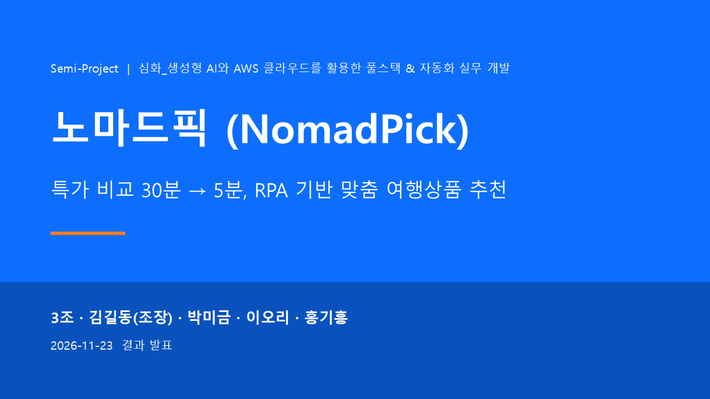 | 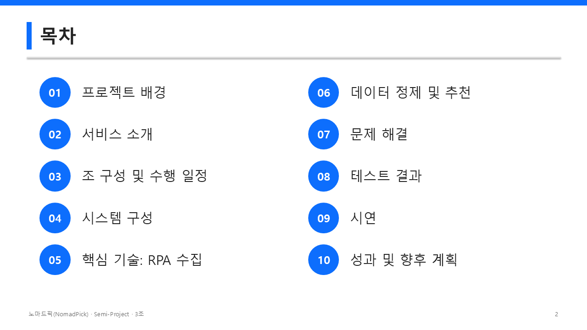 | 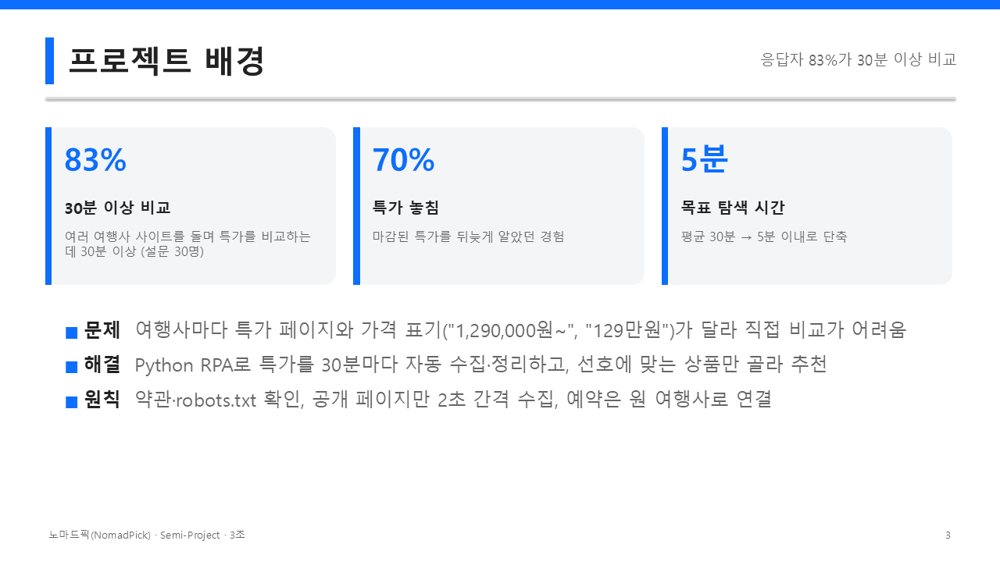 |
| 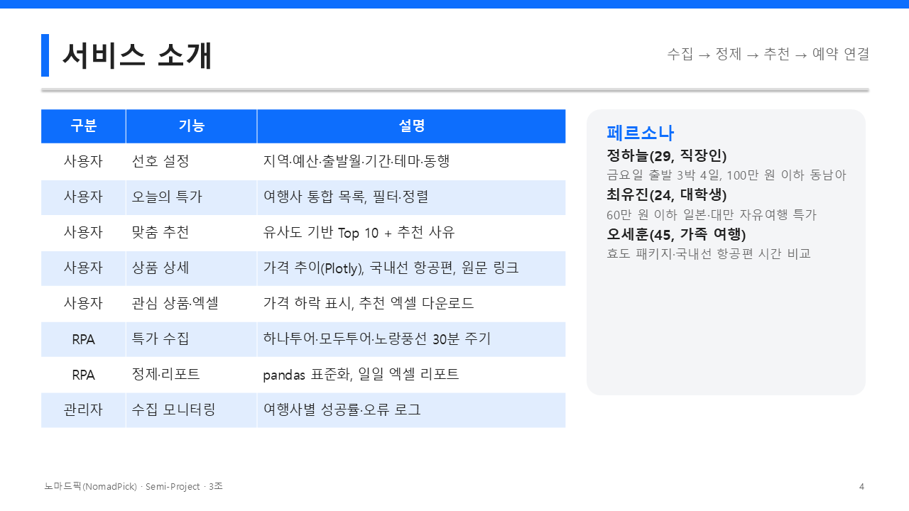 | 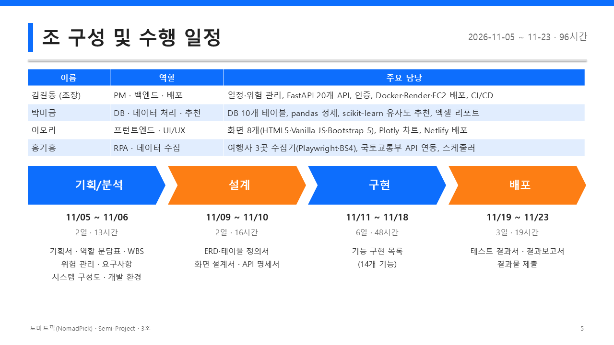 | 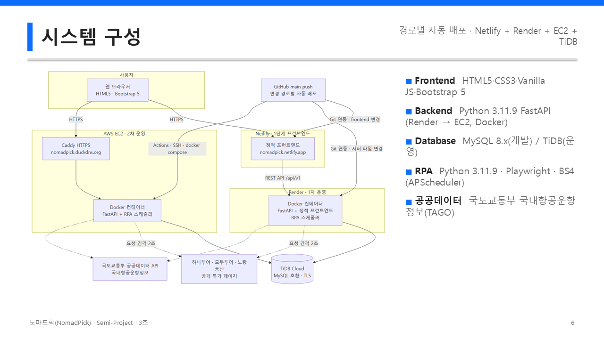 |
| 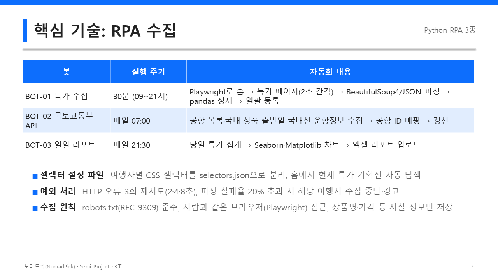 | 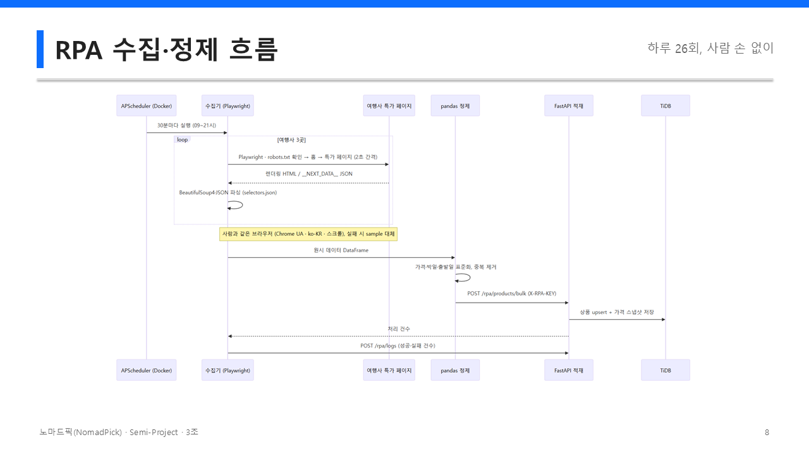 | 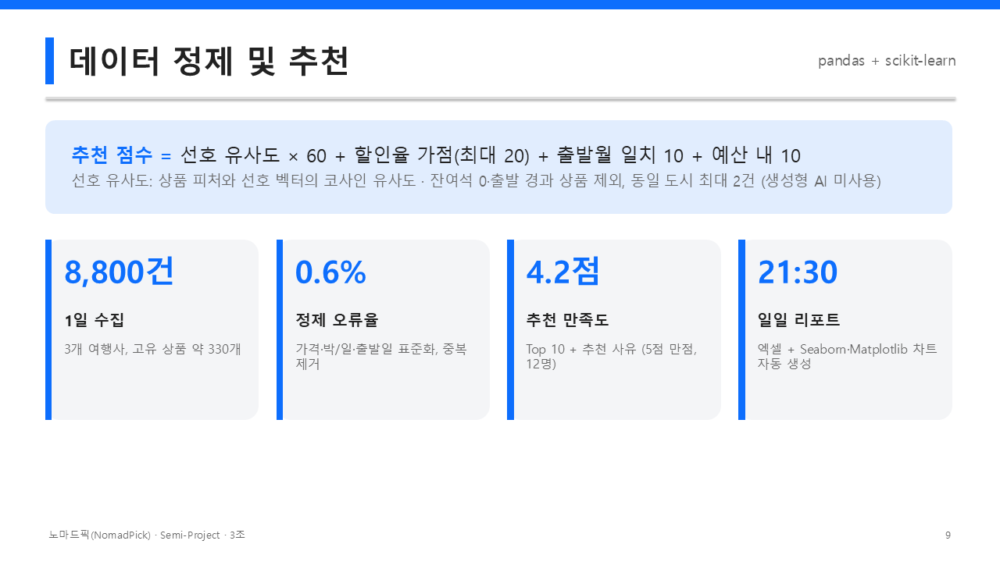 |
| 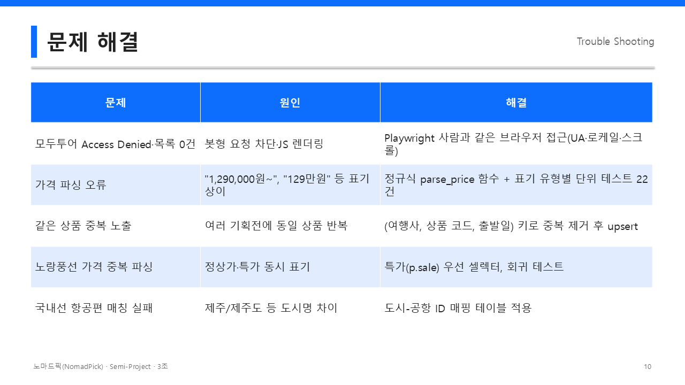 | 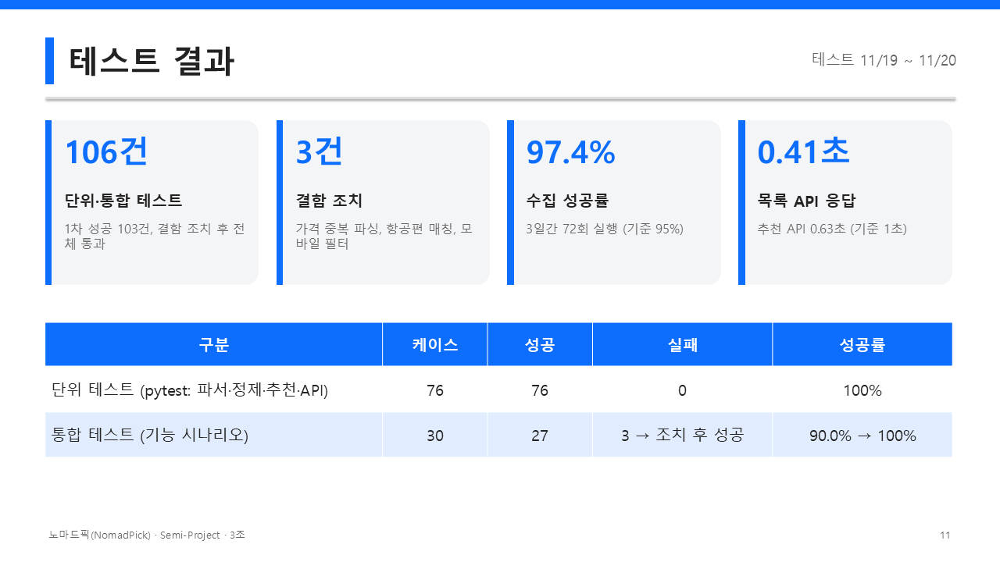 | 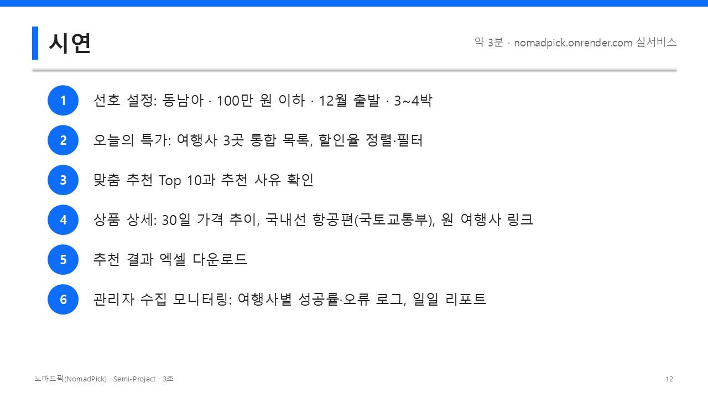 |
| 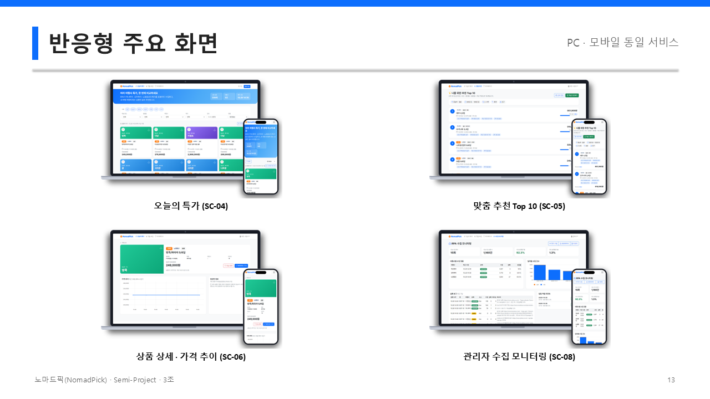 | 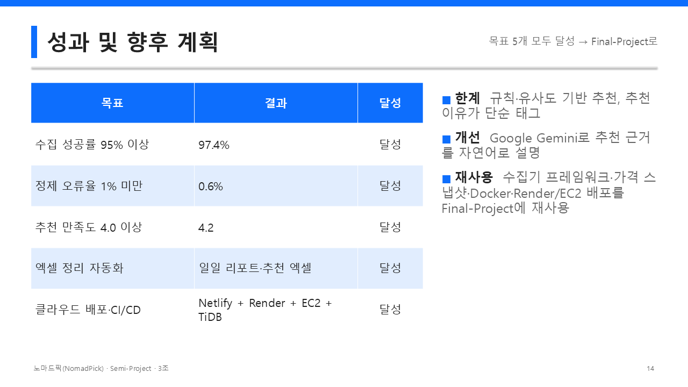 | 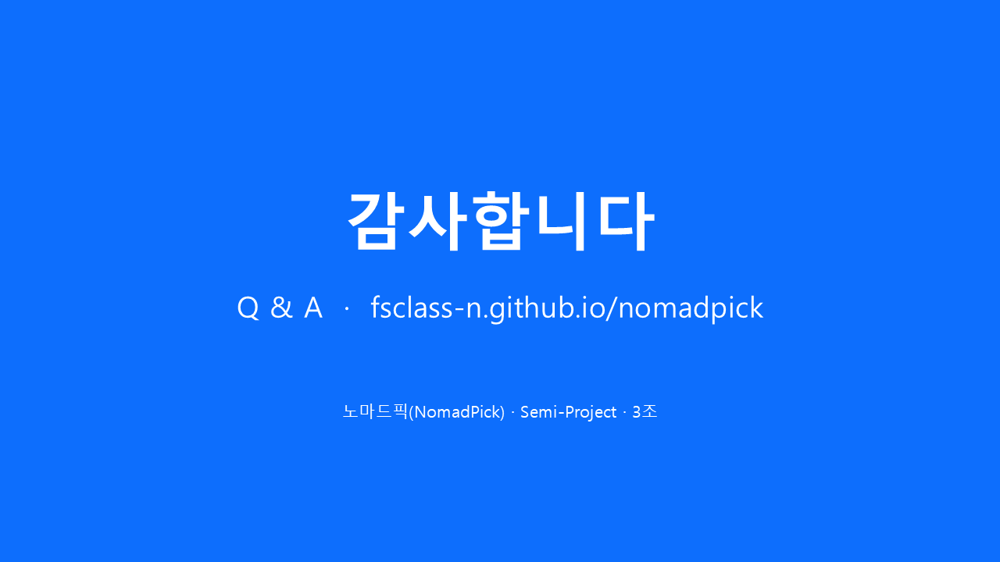 |

### 시연 화면

| 오늘의 특가 (일반) | 맞춤 추천 Top 10 (회원) |
|---|---|
|  |  |
| **상품 상세 · 가격 추이 · 국내선 항공편** | **선호 설정 (회원)** |
|  | 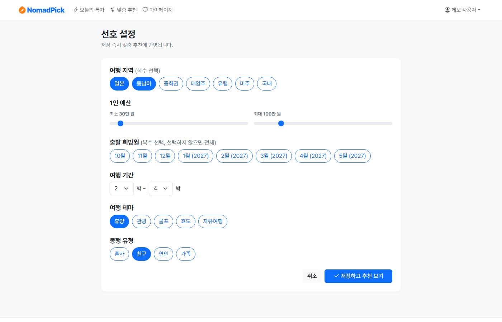 |
| **마이페이지 · 관심 상품 (회원)** | **수집 모니터링 (관리자 전용)** |
| 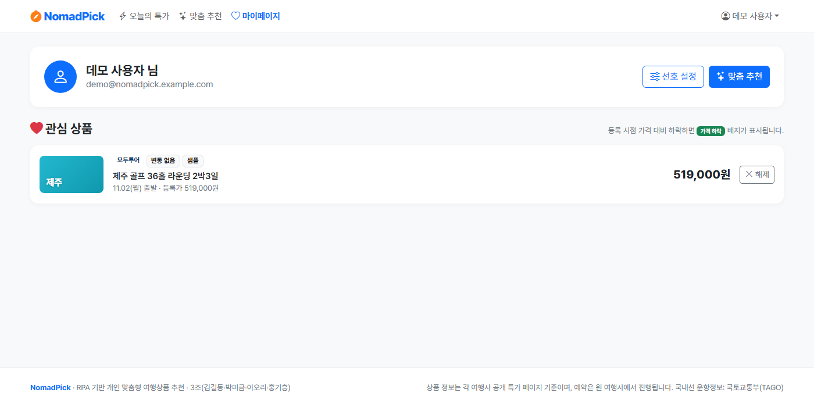 |  |

## 기술 스택

| 구분 | 기술 |
|---|---|
| Frontend | HTML5, CSS3, Vanilla JavaScript, Bootstrap 5, Flexbox, Plotly.js |
| Backend | Python 3.11.9, FastAPI, SQLAlchemy, PyJWT, bcrypt, APScheduler |
| Database | TiDB Cloud (MySQL 8.x 호환, TLS) — 로컬 테스트 포함 모든 환경 |
| RPA / Data | Playwright, BeautifulSoup4, Requests, pandas, NumPy, scikit-learn, Seaborn, Matplotlib, Plotly, openpyxl |
| External | 국토교통부_(TAGO)_국내항공운항정보 API (공공데이터포털) |
| Deploy | Netlify(프런트, Git 연동), Render(Docker, Git 연동), AWS EC2(Docker Compose + Caddy HTTPS), GitHub Actions(테스트·EC2) |

## 폴더 구조

```
nomadpick/
├── backend/app/          # FastAPI (routers, services, models) - /api/v1 + 정적 프런트엔드 제공
├── frontend/             # HTML·CSS·JS (Netlify 단독 배포, 오프라인 데모 데이터 포함)
├── rpa/                  # 수집기(collector: Playwright), 정제(cleaner), 공공데이터(public_data), 리포트(report)
│   └── selectors.json    # 여행사별 홈·특가 페이지 탐색 규칙, CSS 셀렉터/JSON 필드
├── docs/                 # 산출물(hwpx/pdf/pptx), md 작업 기록, 문서 생성 도구(tools)
├── deploy/               # EC2 설정 스크립트, Caddyfile
├── .github/workflows/deploy.yml
├── Dockerfile · docker-compose.yml · render.yaml · netlify.toml
├── requirements.txt      # 파이썬 외부 라이브러리 (단일 파일)
└── .env.example          # 환경 변수 템플릿
```

## 환경 변수 규칙

| 환경 | 방법 |
|---|---|
| 로컬 | 프로젝트 루트 `.env` (`.env.example` 복사 후 입력) |
| EC2 | 서버의 `~/nomadpick/.env` |
| Render | 대시보드 > Environment > **Add from .env** 에 `.env.example` 의 **[1] 공통 필수** 구역만 붙여넣기 |

`.env.example`은 [1] 공통 필수(Render 포함) · [2] 선택(기본값과 같음) · [3] 로컬 전용 · [4] EC2 전용으로 나뉘어 있습니다. `.env`는 Git에 커밋하지 않습니다. `DATABASE_URL`(TiDB)은 필수이며, SQLite는 사용하지 않습니다.

## 로컬 실행

```bash
py -3.11 -m venv .venv
.venv\Scripts\activate            # macOS/Linux: source .venv/bin/activate
pip install -r requirements.txt
playwright install chromium        # RPA 수집용 브라우저
copy .env.example .env             # DATABASE_URL(TiDB nomadpick) 등 입력
uvicorn backend.app.main:app --reload
```

- 웹: http://127.0.0.1:8000 · Swagger: http://127.0.0.1:8000/docs
- 최초 실행 시 DB가 비어 있으면 RPA가 1회 자동으로 수집합니다(`COLLECT_ON_STARTUP=true`).
- RPA 수동 실행: `python -m rpa.run all` (`deals` / `public` / `report`, 옵션 `--mode live|sample|auto --sink direct|api`)
- 테스트: `pytest` → 같은 TiDB 클러스터의 `nomadpick_test` DB를 자동으로 만들어 사용하며, 운영 DB `nomadpick`은 건드리지 않습니다.

## RPA 수집 (Playwright)

여행사 특가 목록은 JavaScript로 렌더링되고, 모두투어는 봇형 HTTP 요청을 Access Denied로 차단합니다.
그래서 `rpa/collector/browser.py`의 `HumanBrowser`가 **일반 사용자의 Chrome과 같은 조건**으로 페이지를 엽니다.

- 실제 Chrome User-Agent, `sec-ch-ua` 헤더, ko-KR 로케일, Asia/Seoul 시간대, 일반 해상도
- `navigator.webdriver` 등 자동화 흔적 제거, `--disable-blink-features=AutomationControlled`
- 홈 화면을 먼저 방문한 뒤 특가 페이지로 이동(Referer·쿠키), 마우스 이동·단계별 스크롤·불규칙한 대기
- 수집 예의: robots.txt 확인(RFC 9309 — 4xx는 제한 없음, 5xx는 수집 안 함), 페이지 간 2초 이상 간격, 3회 재시도(2·4·8초)

| 여행사 | 수집 페이지 | 파싱 |
|---|---|---|
| 하나투어 | 홈 메뉴의 `임박특가` 기획전 | `div.card-wrap` (CSS) |
| 모두투어 | 홈에 노출된 `/promotion/{번호}` 기획전 (최대 3곳) | `__NEXT_DATA__` 상품 JSON |
| 노랑풍선 | 홈 메뉴의 `긴급특가` 기획전 | `ul.list_thum > li` (CSS, 특가 `p.sale` 우선) |

| 모드 | 동작 |
|---|---|
| `auto` (기본) | live 수집 → 실패(사이트 장애·브라우저 미설치)하면 같은 파서로 내장 sample 페이지 수집 (`source=sample`) |
| `live` | Playwright 실사이트만 |
| `sample` | 내장 sample 페이지만 (시연용, 빈 DB면 14일 가격 이력 생성) |

## 배포 (경로별 자동 배포)

`main`에 push하면 **변경된 파일에 따라** 배포 대상이 나뉩니다.
Netlify와 Render는 GitHub 연동으로 자동 배포되고(`netlify.toml`의 `ignore`, `render.yaml`의 `buildFilter`), EC2는 `.github/workflows/deploy.yml`이 테스트 후 SSH로 배포합니다.

| 변경 경로 | Netlify | Render | EC2 |
|---|---|---|---|
| `frontend/**`, `netlify.toml` | O | O | O |
| `backend/**`, `rpa/**`, `requirements.txt`, `Dockerfile` | - | O | O |
| `render.yaml` | - | O | - |
| `docker-compose.yml`, `deploy/**` | - | - | O |
| `docs/**`, `README.md` 등 | - | - | - |

Render·EC2도 프런트엔드를 함께 제공하므로 프런트엔드가 바뀌면 세 곳 모두 배포되고, 백엔드만 바뀌면 Netlify는 배포되지 않습니다.

EC2 배포용 GitHub Secrets는 `EC2_HOST`, `EC2_USER`, `EC2_SSH_KEY`, `TEST_DATABASE_URL`(선택)이고, Variables에는 `EC2_ENABLED=true`를 설정합니다.
자세한 절차는 `docs/md/04_배포.md`에 있습니다.
