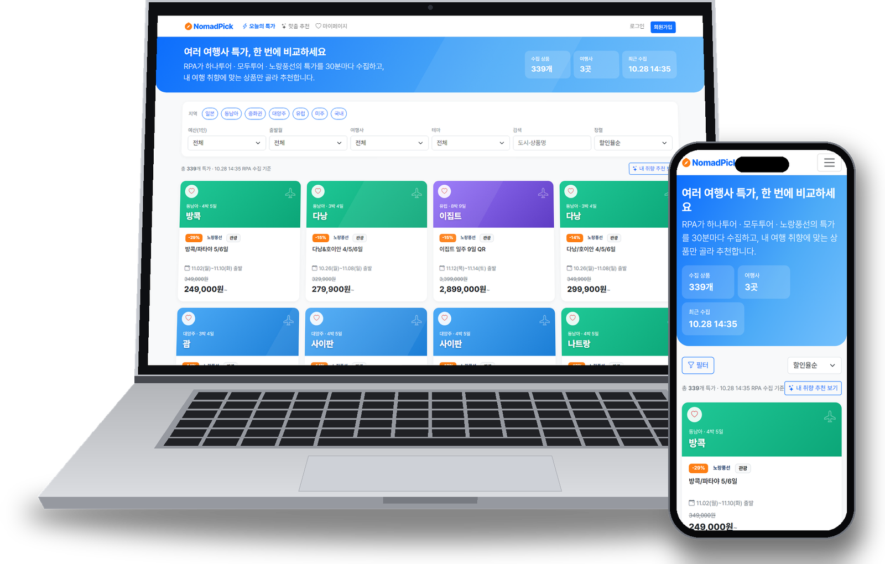
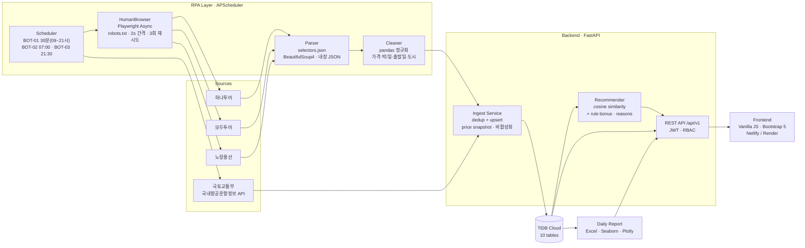

# ✈️ NomadPick — 여행 특가 수집 · 맞춤 추천 플랫폼

> **3개 대형 여행사(하나투어 · 모두투어 · 노랑풍선)의 특가를 Playwright RPA가 30분마다 수집·정제하고,
> 사용자 취향에 맞는 상품을 "추천 이유"와 함께 보여주는 풀스택 · 데이터 자동화 서비스**

<p>
  
  
  
  
  
  
  <br>
  
  
  
  
  
  <br>
  <a href="https://github.com/fsclass-n/nomadpick/actions/workflows/deploy.yml"></a>
  
  
  
  
  
</p>

<p align="center">
  <a href="https://fsclass-n.github.io/nomadpick/"></a>
</p>

<p align="center">
  <a href="https://fsclass-n.github.io/nomadpick/"></a>
</p>

| 서비스 | 주소 |
|---|---|
| 웹 서비스 (Render, API + Frontend) | https://nomadpick.onrender.com · Swagger `/docs` |
| 프런트엔드 (Netlify, 정적 배포) | https://nomadpick.netlify.app |

---

## 📌 Why — 해결한 문제

| 문제 | 수치 (설문 30명) | NomadPick의 해결 |
|---|---|---|
| 여행사마다 사이트를 돌며 특가 비교 | **83%** 가 30분 이상 소요 | 3개 여행사 특가를 **한 화면에 통합** |
| 특가가 마감된 뒤에 알게 됨 | **70%** 경험 | **30분 주기** 자동 수집 + 가격 변동 추적 |
| 내 조건에 맞는 상품 선별이 어려움 | — | 취향 기반 **Top 10 추천 + 추천 이유** |

**결과**: 탐색 시간 30분 → 5분 이내 · 수집 성공률 **97.4%** · 회당 **330+** 상품 · 목록 API **0.41s**

---

## ✨ Key Features

| 구분 | 기능 | 설명 |
|---|---|---|
| 누구나 | **오늘의 특가** | 3사 해외 특가 + 국내 기획전 통합 목록(여행사 상품 이미지), 지역·예산·출발월·여행사·테마 필터, 할인율·가격·출발 임박 정렬, 도시 검색 |
| 회원 | **맞춤 추천 Top 10** | 코사인 유사도 + 가점 규칙, 상품별 **추천 사유 태그**, 결과 엑셀 다운로드 |
| 회원 | **상품 상세** | 30분 단위 가격 스냅샷 기반 가격 추이(Plotly), 국토교통부 국내선 항공편·최저 운임, 원 여행사 예약 연결 |
| 회원 | **관심 상품** | 등록 시점 대비 가격 하락 배지 |
| 관리자 | **RPA 모니터링** | 수집 성공률·파싱 실패율 KPI, 여행사별 상태, 실행 로그, 수동 실행, 일일 엑셀·차트 리포트 |
| 공통 | **반응형 · 오프라인 대비** | PC·모바일 동일 경험, API 장애 시 스냅샷 데이터로 화면 유지 |

---

## 🏗 Architecture & Data Pipeline



### 수집 1회의 흐름 (BOT-01)

```
Scheduler(30m) ─▶ Playwright 브라우저 1개 실행 (저메모리 옵션)
                    └─ 여행사별 새 Context ─▶ robots.txt 확인 ─▶ 홈 방문 ─▶ 현재 특가 기획전 URL 자동 탐색
                         └─ 기획전 방문(2s 간격, 단계별 스크롤) ─▶ 렌더링 HTML / 내장 JSON 파싱
                    └─ Context close · gc ─▶ 다음 여행사
          ─▶ pandas 정제(표준화·검증·중복 제거) ─▶ upsert + 가격 스냅샷 ─▶ 미노출 상품 비활성화 ─▶ 실행 로그
```

---

## 🧩 Key Technical Challenges & Solutions

### 1. 동적 페이지 · 봇 차단 대응과 Playwright 저메모리 최적화

| 문제 | 원인 | 해결 |
|---|---|---|
| `requests + BS4` 수집 0건 | 하나투어·노랑풍선 목록이 **JS 렌더링** | Playwright로 실제 브라우저 렌더링 후 HTML·내장 JSON 파싱 |
| 모두투어 **Access Denied** | 봇형 요청(헤더·지문) 차단 | 실제 Chrome UA + `sec-ch-ua`, `ko-KR` · `Asia/Seoul`, `navigator.webdriver` 제거, 홈 → 기획전 순 방문, 마우스 이동·단계별 스크롤 |
| 기획전 URL이 수시로 바뀜 | 이벤트마다 새 페이지 | `selectors.json` 의 규칙(해외 특가·국내)별 정규식으로 **홈에서 현재 기획전 자동 탐색**, 실패 시 규칙별 기본 URL |
| Render(512MB) **502 / OOM** | Chromium이 이미지·CSS·폰트까지 로딩 | 아래 최적화 적용 |

```python
# rpa/collector/browser.py (요약)
LAUNCH_ARGS = ["--no-sandbox", "--disable-dev-shm-usage", "--disable-gpu", "--no-zygote",
               "--renderer-process-limit=1", "--js-flags=--max-old-space-size=256", ...]

async def _block(route):                       # page.route: 파싱에 불필요한 리소스 차단
    if route.request.resource_type in {"image", "media", "font", "stylesheet", "texttrack", "manifest"}:
        await route.abort()
    else:
        await route.continue_()

async with HumanBrowser() as browser:          # 브라우저·Playwright: __aexit__ try/finally 로 반드시 종료
    for collector in COLLECTORS:
        async with browser.session() as s:     # 여행사마다 Context 생성 → 종료 즉시 메모리 반환
            await collector.collect(s)
        gc.collect()
```

- **Async API** 로 대기 시간 동안 이벤트 루프를 점유하지 않고, 스케줄러 스레드·FastAPI BackgroundTasks 에서는 `asyncio.run` 래퍼로 호출
- **예의 있는 수집**: robots.txt(RFC 9309) 준수, 요청 간 2초+, HTTP 오류 3회 재시도(2·4·8초), 공개된 사실 정보(상품명·가격·일정)만 저장
- **Docker**: Microsoft 공식 `mcr.microsoft.com/playwright/python` 이미지, `MALLOC_ARENA_MAX=2`, 워커 1개, non-root 실행

### 2. 30분 주기 동기화 · 정제 · 중복 처리

| 과제 | 전략 |
|---|---|
| 제각각인 표기 `"1,290,000원~"` `"129만원"` `"11/10,17,24"` `"3박4일"` | 정규식 파서 + pandas 벡터 연산으로 가격·박/일·출발일(단일/기간)·지역/도시 표준화, 표기 유형별 단위 테스트 |
| 여러 기획전에 같은 상품 반복 노출 | **(여행사, 상품 코드, 출발일)** 복합 키로 중복 제거 후 `upsert` |
| 가격 변동 이력 | 수집 회차마다 **가격 스냅샷** 적재 → 상세 차트 · 관심 상품 가격 하락 판단 |
| 특가 종료 상품 | 이번 회차에 보이지 않은 상품 자동 **비활성화**, 잔여석 0·출발 경과 상품 제외 |
| 수집 실패 시 데이터 오염 | `auto` 모드에서 live 실패 시 **기존 실데이터 유지**(sample 로 덮어쓰지 않음), 파싱 실패율 20% 초과 시 WARN |
| 동시 실행 · 중복 스케줄 | 프로세스 락 + 단일 워커, 실행 로그로 성공률·실패 원인 추적 |
| 분류 오류 (예: "부산출발 세부" → 국내 부산) | 출발지 표기 제거 후 **해외 도시 우선 매칭** + 회귀 테스트 |
| 국내 상품 출발일 미표기 (하나투어 울릉도/섬 등) | 수집일~+60일 **상시 출발**로 저장, 매일 같은 상품 행을 이어 써 가격 이력 유지 |

### 3. 맞춤 추천 알고리즘과 추천 사유 산출

```
score = cosine(user_vector, product_vector) × 60      # 지역 · 테마 · 기간 · 동행 one-hot/정규화 피처
      + min(discount_rate, 40) / 40 × 20               # 할인율 가점 (최대 20)
      + 10 · [출발월 일치] + 10 · [예산 범위 내]
```

- **필터 → 스코어링 → 다양성 규칙**: 잔여석 0 · 출발 경과 · 비활성 상품 제외 → 점수 정렬 → 같은 상품 1건 · 같은 도시 최대 2건
- **콜드 스타트**: 선호 미설정 사용자는 할인율 순 추천 + `선호 미설정 - 할인율 순 추천` 사유 표시
- **설명 가능한 추천**: 점수에 기여한 조건을 그대로 태그로 반환 — `선호 지역 일치` · `예산 100만 원 이내` · `12월 출발` · `할인율 25%`(20% 이상)
- 생성형 AI 없이 규칙 + 유사도 기반으로 **결정적이고 테스트 가능한** 결과 (향후 LLM 자연어 설명 확장 예정)

---

## 🛠 Tech Stack

| 영역 | 기술 |
|---|---|
| **Backend** | Python 3.11 · FastAPI · SQLAlchemy 2 · Pydantic · JWT(PyJWT) · bcrypt · APScheduler · openpyxl |
| **Frontend** | HTML5 · CSS3(Flexbox) · Vanilla JavaScript · Bootstrap 5 · Plotly.js |
| **RPA / Data** | Playwright(Async) · BeautifulSoup4 · Requests · pandas · NumPy · scikit-learn · Seaborn · Matplotlib |
| **External API** | 국토교통부 국내항공운항정보(TAGO, data.go.kr) |
| **Database** | TiDB Cloud (MySQL 8 호환) — 운영 `nomadpick` / 테스트 `nomadpick_test` 분리 |
| **Infra / DevOps** | Docker(Microsoft Playwright image) · Render · Netlify · AWS EC2 + Caddy(HTTPS) · GitHub Actions(경로별 배포) |
| **Test** | pytest 77건 (파서 · 정제 · 추천 · API 통합) |

---

## 🔌 API Architecture

`/api/v1` · JWT Bearer 인증 · 역할 기반 접근(USER / ADMIN) · RPA 적재는 `X-RPA-KEY`

| 그룹 | 엔드포인트 | 권한 |
|---|---|---|
| Auth | `POST /auth/signup` · `POST /auth/login` · `GET /users/me` | 공개 / 회원 |
| Products | `GET /meta` · `GET /products` · `GET /products/{id}` · `GET /products/{id}/prices` | 공개 |
| Preferences | `GET /preferences` · `PUT /preferences` | 회원 |
| Recommendations | `GET /recommendations` · `GET /recommendations/excel` | 회원 |
| Favorites | `GET /favorites` · `POST /favorites` · `DELETE /favorites/{product_id}` | 회원 |
| Admin | `GET /admin/rpa-logs` · `GET /admin/reports` · `GET /admin/reports/{date}` · `POST /admin/rpa/run` | 관리자 |
| RPA Ingest | `POST /rpa/products/bulk` · `PUT /rpa/flights` · `PUT /rpa/airports` · `POST /rpa/logs` · `POST /rpa/reports` | RPA 키 |
| Health | `GET /health` | 공개 |

---

## 📁 Directory Structure

```
nomadpick/
├── backend/app/
│   ├── main.py              # FastAPI 앱, 라우터·정적 파일·스케줄러 기동
│   ├── config.py            # .env 설정 (TiDB, JWT, Playwright 옵션)
│   ├── models.py            # SQLAlchemy 모델 10개 (상품·가격 스냅샷·선호·관심·로그·리포트 …)
│   ├── routers/             # auth · products · preferences · recommendations · favorites · admin · rpa
│   ├── services/            # ingest(upsert·스냅샷) · recommend(유사도·사유) · excel · bootstrap
│   └── scheduler.py         # APScheduler: BOT-01/02/03
├── rpa/
│   ├── collector/           # browser.py(HumanBrowser, Async) · base.py · agencies.py · robots.py
│   ├── cleaner/normalize.py # pandas 정제·표준화·중복 제거
│   ├── public_data/         # 국토교통부 국내선 운항정보
│   ├── report/              # 일일 엑셀·차트 리포트
│   ├── selectors.json       # 여행사별 셀렉터·기획전 탐색 규칙
│   ├── sink.py              # direct(DB) / api(X-RPA-KEY) 적재
│   └── run.py               # python -m rpa.run deals|public|report|all
├── frontend/                # index · recommend · product · preferences · mypage · admin (+ js/, css/)
├── docs/                    # 기획·설계·구현·배포·테스트 문서, 발표자료, 시연 영상
├── Dockerfile · render.yaml · netlify.toml · docker-compose.yml
└── .github/workflows/deploy.yml   # 테스트 → 경로별 배포(EC2)
```

---

## 🚀 Getting Started

```bash
py -3.11 -m venv .venv && .venv\Scripts\activate
pip install -r requirements.txt && playwright install chromium
copy .env.example .env                    # DATABASE_URL(TiDB), JWT_SECRET 등 입력

uvicorn backend.app.main:app --reload     # http://127.0.0.1:8000  (Swagger: /docs)
python -m rpa.run all                     # 수집 → 공공데이터 → 리포트 1회 실행
pytest                                    # TiDB nomadpick_test 로 77건 테스트
```

---

## 👥 Team

| 이름 | 역할 | 담당 |
|---|---|---|
| 김길동 (조장) | PM · Backend · DevOps | FastAPI API 설계, 인증/권한, Docker · Render · EC2 배포, CI/CD |
| 박미금 | DB · Data · 추천 | TiDB 스키마, pandas 정제, 유사도 추천, 엑셀 리포트 |
| 이오리 | Frontend · UI/UX | 반응형 화면 8종, Plotly 차트, Netlify 배포 |
| 홍기흥 | RPA · 수집 | Playwright 수집기 3종, 국토교통부 API 연동, 스케줄러 |

---

## 📚 Docs

[기획·설계·구현·배포·테스트 기록](docs/md/00_목차.md) · [배포 가이드](docs/md/04_배포.md) · [발표자료 PDF](docs/pdf/프로젝트_발표자료.pdf) · [산출물](docs)

<sub>Semi-Project · 심화_생성형 AI와 AWS 클라우드를 활용한 풀스택 &amp; 자동화 실무 개발 · 3조</sub>
