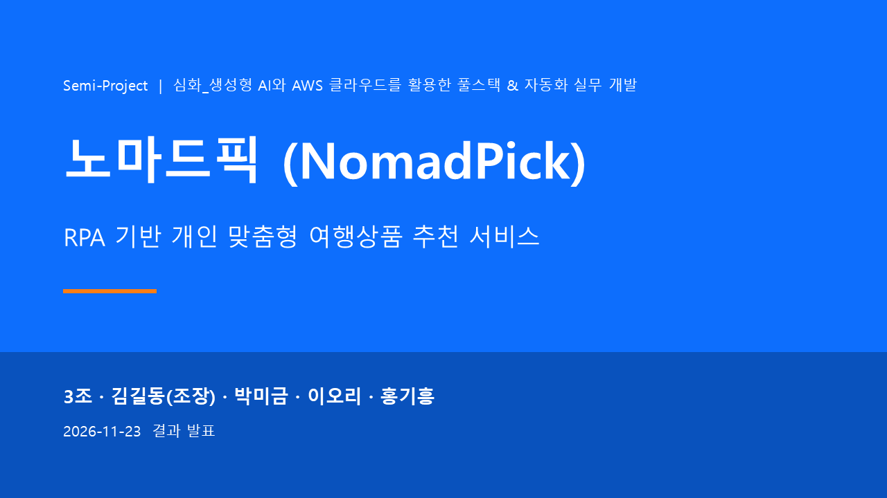

# NomadPick (노마드픽)

<p align="center">
  <a href="https://fsclass-n.github.io/nomadpick/"></a>
  <br><b><a href="https://fsclass-n.github.io/nomadpick/">▶ 프로젝트 소개 페이지 · 10분 시연 영상 보기</a></b>
</p>

> RPA(Playwright)가 하나투어·모두투어·노랑풍선의 특가를 30분마다 수집·정제하고, 취향에 맞는 여행상품을 추천 이유와 함께 보여주는 서비스
> — Semi-Project 3조 · 김길동(조장), 박미금, 이오리, 홍기흥

| 구분 | 주소 |
|---|---|
| 소개 페이지 · 시연 영상 | https://fsclass-n.github.io/nomadpick/ |
| 발표 화면 (PPTX 슬라이드쇼) | https://fsclass-n.github.io/nomadpick/docs/presentation/ |
| 서비스 (Render) | https://nomadpick.onrender.com · API 문서 `/docs` |
| 프런트엔드 (Netlify) | https://nomadpick.netlify.app |

## 핵심 기능
- **오늘의 특가**: 3개 여행사 통합 목록, 지역·예산·출발월·여행사·테마 필터와 정렬
- **맞춤 추천 Top 10**: 코사인 유사도 + 할인율·출발월·예산 가점, 추천 이유 태그, 엑셀 다운로드
- **상품 상세**: 30일 가격 추이, 국내선 항공편(국토교통부 API), 관심 상품 가격 하락 알림
- **관리자**: RPA 수집 모니터링, 실행 로그, 수동 실행, 일일 엑셀·차트 리포트

## 기술 스택
`HTML5` `Bootstrap 5` `Vanilla JS` · `Python 3.11` `FastAPI` `SQLAlchemy` · `Playwright` `BeautifulSoup4` `pandas` `scikit-learn` · `TiDB` · `Docker` `Render` `Netlify` `AWS EC2` `GitHub Actions`

## 실행
```bash
py -3.11 -m venv .venv && .venv\Scripts\activate
pip install -r requirements.txt && playwright install chromium
copy .env.example .env               # DATABASE_URL(TiDB) 등 입력
uvicorn backend.app.main:app --reload # http://127.0.0.1:8000
pytest                                # TiDB nomadpick_test 로 테스트
```

## 문서
| 문서 | 위치 |
|---|---|
| 기획·설계·구현·배포·테스트 기록 | [docs/md](docs/md/00_목차.md) |
| 발표·시연 대본 | [docs/md/07_발표영상_대본.md](docs/md/07_발표영상_대본.md) |
| 산출물 (hwpx/PDF), 발표자료 | [docs/](docs) · [docs/pdf](docs/pdf) |
| 배포 (Netlify·Render·EC2, 환경 변수) | [docs/md/04_배포.md](docs/md/04_배포.md) |
