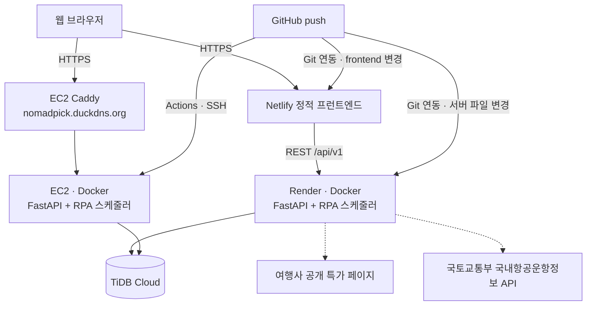

# 02. 설계

## 시스템 구성도



## ERD (10개 테이블)

| 테이블 | 설명 | 주요 컬럼 |
|---|---|---|
| users | 회원 | email(UK), password_hash(bcrypt), role(USER/ADMIN) |
| user_preferences | 선호 설정 | regions(JSON), budget_min/max, depart_months(JSON), nights_min/max, theme, companion |
| agencies | 여행사 | code(hanatour/modetour/ybtour), name, base_url, robots_checked_at |
| travel_products | 여행 상품 | UNIQUE(agency_id, product_code, depart_date), depart_end(출발 기간 마지막 날), price, original_price, discount_rate, seats_left, source(live/sample) |
| price_snapshots | 가격 이력 | product_id, price, seats_left, collected_at (INDEX product_id+collected_at) |
| airports | 공항(국토교통부) | airport_id(NAARKPC 등), airport_nm, city |
| flight_schedules | 국내선 운항정보(국토교통부) | flight_date, dep/arr_airport_id, airline_nm, flight_no, dep/arr_time, economy_charge |
| favorites | 관심 상품 | user_id, product_id, saved_price |
| rpa_job_logs | 수집 실행 로그 | job_name(BOT-01~03), agency_id, status, source, collected, failed, retries |
| excel_reports | 일일 리포트 | report_date(UK), file_blob(xlsx), chart_html(Plotly), summary(JSON) |

### 추천 점수
```
점수 = 코사인 유사도(선호 벡터, 상품 피처) × 60 + 할인율 가점(최대 20) + 출발월 일치 10 + 예산 범위 내 10
 - 상품 피처: 지역 원-핫(가중 1.5) + 테마 원-핫 + 가격/300만 + 박수/10
 - 제외: 잔여석 0, 출발(기간) 종료, 최근 수집 미노출(is_active=false)
 - 출발월 일치: 출발 기간 상품은 기간 안의 모든 월을 비교
 - 다양성: 같은 상품(출발일만 다름) 1건, 같은 도시 최대 2건
 - 선호 미설정: 할인율 순
```

## API 명세 (Base URL `/api/v1`, Swagger `/docs`)

| No | Method | URI | 설명 | 인증 |
|---|---|---|---|---|
| 1 | POST | /auth/signup | 회원가입 | - |
| 2 | POST | /auth/login | 로그인(JWT) | - |
| 3 | GET | /users/me | 내 정보 | JWT |
| 4 | GET | /preferences | 선호 조회 | JWT |
| 5 | PUT | /preferences | 선호 저장 | JWT |
| 6 | GET | /products | 특가 목록(region, price_min/max, month, agency, theme, q, sort, page, size) | - |
| 7 | GET | /products/{id} | 상품 상세(국내선 항공편 포함) | - (JWT 시 관심 여부) |
| 8 | GET | /products/{id}/prices | 가격 이력(기본 30일) | - |
| 9 | GET | /recommendations | 맞춤 추천 Top 10 | JWT |
| 10 | GET | /recommendations/excel | 추천 엑셀 다운로드 | JWT |
| 11 | GET | /favorites | 관심 상품 목록 | JWT |
| 12 | POST | /favorites | 관심 등록 | JWT |
| 13 | DELETE | /favorites/{productId} | 관심 해제 | JWT |
| 14 | POST | /rpa/products/bulk | 상품 일괄 upsert + 스냅샷 | X-RPA-KEY |
| 15 | PUT | /rpa/flights | 국내선 운항정보 갱신 | X-RPA-KEY |
| 16 | PUT | /rpa/airports | 공항 목록 갱신 | X-RPA-KEY |
| 17 | POST | /rpa/logs | 수집 로그 등록 | X-RPA-KEY |
| 18 | POST | /rpa/reports | 일일 리포트 업로드 | X-RPA-KEY |
| 19 | GET | /admin/rpa-logs | 수집 이력·통계 | JWT(ADMIN) |
| 20 | GET | /admin/reports/{date} | 리포트 다운로드(xlsx / html) | JWT(ADMIN) |
| 보조 | GET | /health, /meta, /admin/reports | 헬스 체크, 필터 코드값·통계, 리포트 목록 | - / ADMIN |
| 보조 | POST | /admin/rpa/run?job= | RPA 수동 실행 | JWT(ADMIN) |

오류 응답 형식: `{ "code": "PRODUCT_NOT_FOUND", "message": "상품을 찾을 수 없습니다." }`

## 화면 목록

| ID | 화면 | 파일 |
|---|---|---|
| SC-01 | 로그인 | login.html |
| SC-02 | 회원가입 | signup.html |
| SC-03 | 선호 설정 | preferences.html |
| SC-04 | 오늘의 특가 | index.html |
| SC-05 | 맞춤 추천 | recommend.html |
| SC-06 | 상품 상세 | product.html?id= |
| SC-07 | 마이페이지 | mypage.html |
| SC-08 | 관리자 수집 모니터링 | admin.html |

## RPA 자동화 흐름

| 봇 | 주기(APScheduler, KST) | 처리 |
|---|---|---|
| BOT-01 특가 수집 | 0,30분 09~21시 | Playwright(사람 같은 브라우저) → robots.txt 확인 → 홈 방문·특가 페이지 탐색 → 렌더링 HTML/JSON 파싱(selectors.json) → pandas 정제 → upsert + 스냅샷 → 로그 |
| BOT-02 국토교통부 API | 매일 07:00 | 공항 목록 → 국내 상품 출발일(30일 이내) 김포→목적지 운항정보 → 갱신 → 로그 |
| BOT-03 일일 리포트 | 매일 21:30 | 활성 상품 집계 → Seaborn·Matplotlib 차트(엑셀 삽입) + Plotly HTML → 저장 → 로그 |
