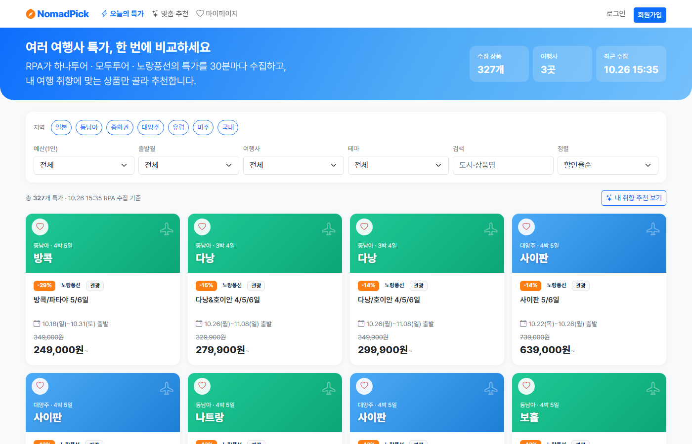
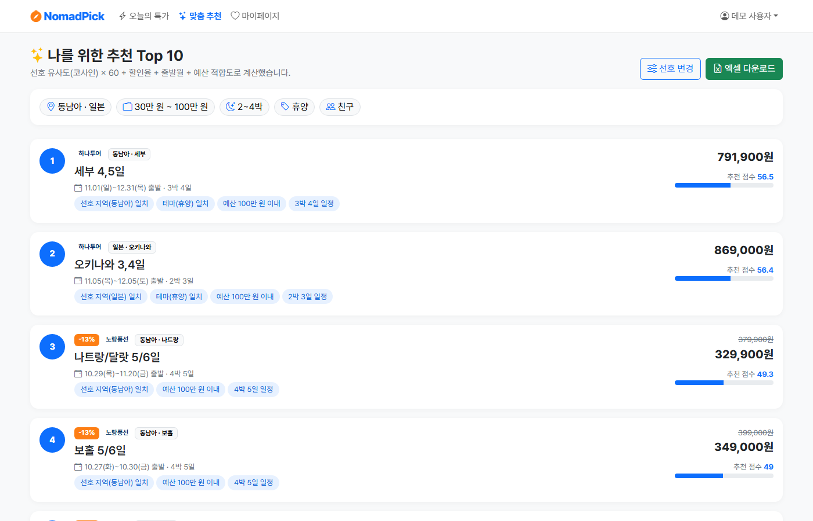
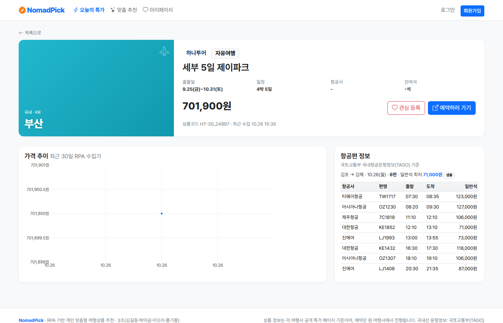
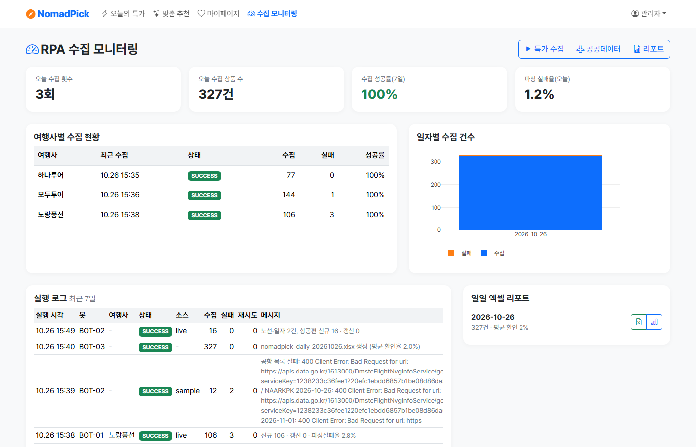

# 03. 구현 (작업 1·2단계)

## 1단계 - 프런트엔드 (Netlify 배포용)

- 순수 HTML5 + CSS3 + Vanilla JS + Bootstrap 5.3(CDN) + Bootstrap Icons + Pretendard + Plotly.js
- 화면 8개: `index` `login` `signup` `preferences` `recommend` `product` `mypage` `admin`
- `frontend/js/config.js`: 접속 위치에 따라 API 주소를 정한다
  - Netlify(`*.netlify.app`) 또는 파일 직접 열기 → `https://nomadpick.onrender.com/api/v1`
  - Render·EC2·로컬(FastAPI가 프런트엔드를 함께 제공) → 같은 도메인의 `/api/v1`
- `frontend/data/sample-products.json`: 백엔드 연결이 실패하면(1단계 단독 배포, Render 슬립) 공개 화면을 이 오프라인 데이터로 표시
  - TiDB에 적재된 실제 수집 데이터의 스냅샷이며, `python -m rpa.export_sample`로 갱신
- 출발 기간 상품은 `11.01(일)~12.31(목) 출발`처럼 기간으로 표시
- 반응형: 카드 4열 → 2열 → 1열(Flexbox), 모바일 필터는 `offcanvas-lg`(BUG-03 조치)

| 오늘의 특가 | 맞춤 추천 |
|---|---|
|  |  |
| **상품 상세** | **관리자 모니터링** |
|  |  |

## 2단계 - 백엔드 (FastAPI)

```
backend/app/
├── main.py           # 앱, CORS(Netlify 도메인), 예외 형식, /api/v1 라우터, 정적 프런트엔드 마운트
├── config.py         # 루트 .env(로컬·EC2) 로드, Render 는 대시보드 환경 변수, DATABASE_URL 필수
├── database.py       # TiDB 엔진 (TLS(certifi), pool_pre_ping, pool_recycle=280)
├── models.py         # 10개 테이블 (travel_products.depart_end: 출발 기간 마지막 날)
├── security.py       # bcrypt, JWT(HS256), X-RPA-KEY
├── scheduler.py      # APScheduler (BOT-01/02/03), DB 비면 최초 1회 수집
├── routers/          # auth, preferences, products, recommendations, favorites, rpa, admin
└── services/         # ingest(upsert·스냅샷), recommend(코사인 유사도), excel, products, bootstrap
```

- DB 연결: TiDB `mysql+pymysql://...:4000/nomadpick` + `DB_SSL=true` (SQLite 미사용, 로컬 테스트도 TiDB)
- 최초 실행 시 여행사·공항 코드와 관리자/데모 계정(`.env`의 ADMIN_*/DEMO_*)을 생성

## 2단계 - RPA (Playwright)

```
rpa/
├── selectors.json            # 여행사별 홈·특가 페이지 탐색 정규식, CSS 셀렉터 / JSON 필드, 제외 키워드
├── catalog.py                # 도시(약 300개)→지역/국가 사전, 테마 키워드, 샘플 카탈로그
├── collector/
│   ├── browser.py            # HumanBrowser: 사람처럼 동작하는 Playwright Chromium, 재시도(2·4·8초)
│   ├── robots.py             # robots.txt 판단 (RFC 9309)
│   ├── base.py               # 홈 방문 → 특가 페이지 탐색 → 파싱, live / sample / auto
│   ├── agencies.py           # 하나투어(card-wrap)·모두투어(__NEXT_DATA__ JSON)·노랑풍선(list_thum, 특가 우선)
│   └── sample_site.py        # 실제 페이지와 같은 마크업의 샘플 페이지 (auto 대체·테스트용)
├── cleaner/normalize.py      # 가격·박/일(복수 일정)·출발일(기간·목록)·잔여석 표준화, 지역·테마 분류 (pandas)
├── public_data/molit_flight.py  # 국토교통부 국내항공운항정보 (공항 목록, 운항정보)
├── report/daily_report.py    # pandas 집계 + Seaborn·Matplotlib(엑셀 삽입) + Plotly HTML
├── sink.py                   # direct(DB) / api(X-RPA-KEY) 적재
├── run.py                    # python -m rpa.run deals|public|report|all
└── export_sample.py          # 프런트엔드 오프라인 데이터(TiDB 스냅샷) 생성
```

### 사람과 같은 브라우저 접근 (`HumanBrowser`)
- 실제 Chrome 131 User-Agent, `sec-ch-ua`·`sec-ch-ua-platform` 헤더, `Accept-Language: ko-KR`, Asia/Seoul 시간대, 일반 해상도(1366~1920)
- `navigator.webdriver`·plugins·languages·`window.chrome` 보정, `--disable-blink-features=AutomationControlled`
- 홈 화면 먼저 방문 → Referer와 함께 특가 페이지 이동 → 마우스 이동, 단계별 휠 스크롤(지연 로딩 목록 표시), 불규칙한 대기
- 이미지·영상·폰트는 받지 않아 메모리와 트래픽을 줄임(`PLAYWRIGHT_BLOCK_MEDIA`)
- robots.txt: 2xx는 규칙 준수, 4xx는 제한 없음(모두투어 robots.txt 403), 5xx·오류는 수집 안 함 / 페이지 간 2초 이상 간격

### live 수집 결과 (2026-10-26, TiDB `nomadpick`)
| 여행사 | robots.txt | 수집 페이지 | 적재 | 파싱 실패율 |
|---|---|---|---|---|
| 하나투어 | 규칙(허용) | 임박특가 기획전 | 77건 | 0.0% |
| 모두투어 | 403 → 제한 없음 | 기획전 3곳 (`/promotion/{번호}`) | 144건 | 0.7% |
| 노랑풍선 | 규칙(`/api/` 제외 허용) | 긴급특가 기획전 | 106건 | 2.8% |

- 1회 수집 소요 약 4분(여행사 3곳, 페이지 6~7개)
- 왕복 항공권처럼 패키지가 아닌 항목은 `exclude_keywords`로 제외

### 국토교통부 API
- 서비스: `https://apis.data.go.kr/1613000/DmstcFlightNvgInfo` (`GetArprtList`, `GetFlightOpratInfoList`) — 2026-03 개편으로 바뀐 경로·대문자 오퍼레이션명
- `.env`의 `DATA_GO_KR_KEY`에 공공데이터포털 서비스 키를 입력합니다. 국내 상품 출발일의 김포 출발 항공편과 일반석 운임을 상품 상세에 표시합니다.

## 실행

```bash
.venv\Scripts\python.exe -m uvicorn backend.app.main:app --reload   # http://127.0.0.1:8000
.venv\Scripts\python.exe -m rpa.run all                             # 수동 수집 (auto)
.venv\Scripts\python.exe -m pytest                                   # 테스트 76건 (TiDB nomadpick_test)
```
